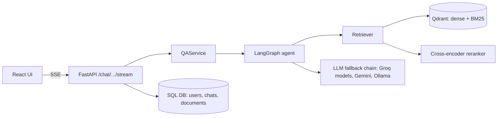
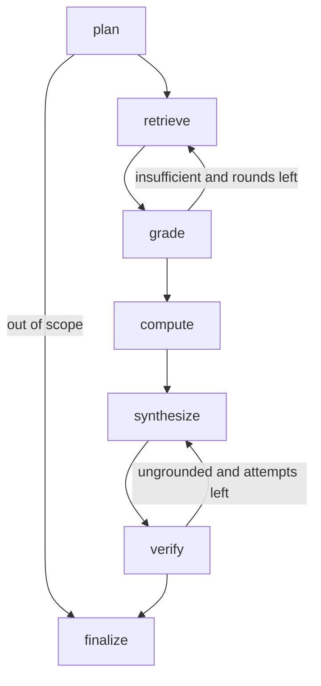

# Architecture

## Request flow (agentic mode)



## Agent graph



| Node | Job | LLM? |
|---|---|---|
| plan | split the question into sub-questions with company/year filters; flag out-of-scope | yes |
| retrieve | hybrid search + rerank per sub-question, merge and dedupe | no |
| grade | is the evidence enough? if not, propose reworded sub-questions | yes |
| compute | pick arithmetic needed (growth, margin), run it with a safe calculator | yes (+ tool) |
| synthesize | write the answer with `[TICKER FYyyyy p.N]` citations | yes |
| verify | every number must appear in the evidence or a calculation; citations must exist | no (deterministic) |
| finalize | add a warning if figures are unverified | no |

Loops are bounded (`AgentConfig.max_rounds`, `max_synth_attempts`) so cost and latency are capped.

## Layers (dependencies point down)

```
api/        HTTP routes, auth and rate-limit dependencies, SSE
services/   QAService (3 modes), document services
agent/      graph, nodes, tools (calculator), grounding check, prompts
retrieval/  embedder, vector store, reranker, retriever
ingestion/  pdf loader, chunker, pipeline
llm/        provider interface, Groq/Gemini/Ollama, fallback
db/         SQLAlchemy models and repositories
core/       config, security, logging, rate limiter
container.py  wires concrete components (the only place that knows them all)
```

## Decisions

- **PDF-only source, no data APIs:** keeps the project focused on retrieval and answer quality.
- **Tables kept whole as markdown chunks:** financial answers live in tables; splitting rows loses the headers.
- **Contextual prefix on embeddings** (`TCS FY2024 annual report, page 12`): helps queries that name a company or year.
- **Deterministic numeric verification instead of an LLM judge:** cheap, explainable, and catches the most harmful failure (invented numbers).
- **Calculator tool:** the model never does arithmetic itself.
- **Provider fallback:** free tiers rate-limit; the chain keeps the app answering.
- **fastembed (ONNX) not torch:** small install, runs on CPU.
- **SQLite + embedded Qdrant by default, Postgres + Qdrant server via env:** runs with zero setup, same code path for Docker.

## Known limitations

- Scanned (image-only) PDFs are not supported; there is no OCR.
- Table extraction quality depends on the PDF; the cited page lets users verify.
- The number check is lexical: it catches invented figures, not wrong reasoning over correct figures.
- Rate limiting and ingestion locking are in-process; scaling to several workers needs Redis and a job queue (deliberately left out to keep the project simple).
- Tables are created with `create_all`; a real deployment should add Alembic migrations.
